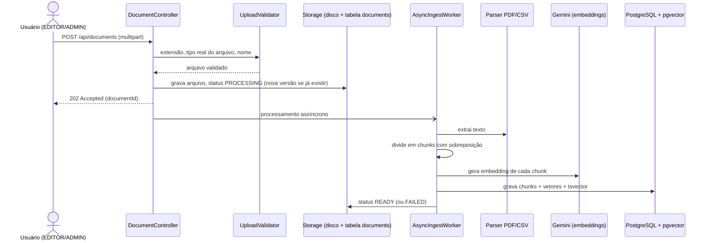
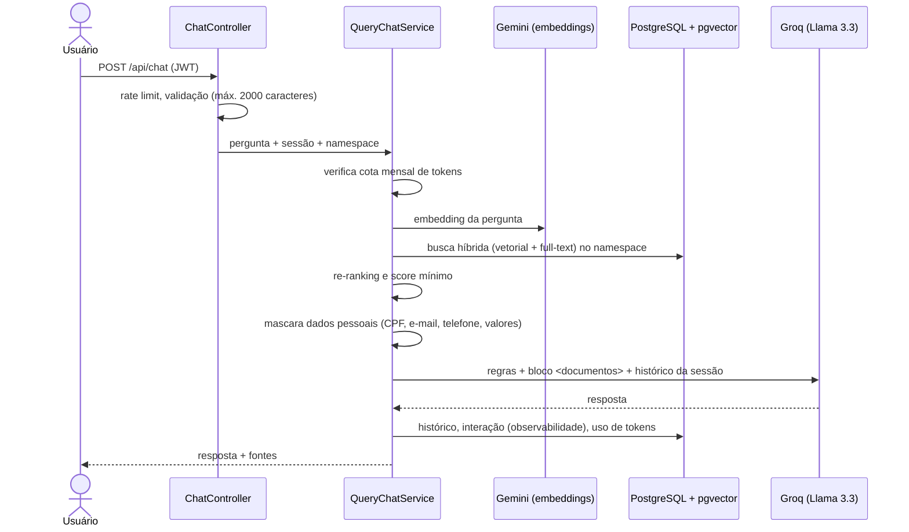

# Crivo

Assistente que responde perguntas sobre documentos internos (PDF e CSV) usando RAG, com busca híbrida em PostgreSQL/pgvector e controle de acesso por perfil.

**Resultado:** em uso interno, reduziu em 48% o tempo gasto respondendo dúvidas da produção.

Stack: Java 21, Spring Boot 3.2, Spring Security (JWT), PostgreSQL 16 + pgvector, Flyway, Docker, JUnit 5, Mockito, Testcontainers.

---

## Como rodar

Pré-requisitos: Java 21, Maven 3.9 e Docker.

```bash
docker compose up -d
export GROQ_API_KEY=sua_chave_groq GOOGLE_API_KEY=sua_chave_google
mvn spring-boot:run
```

Acesse `http://localhost:8080`. Em desenvolvimento, o usuário inicial é `admin` / `Admin@123` (criado pela migration V3). Em produção a aplicação não sobe com essa senha: defina `RAGBOT_ADMIN_PASSWORD` e as demais variáveis de `.env.example`.

---

## Provedores de IA

| Uso | Provedor | Modelo |
|---|---|---|
| Geração de respostas | Groq | Llama 3.3 70B (`llama-3.3-70b-versatile`) |
| Embeddings | Google Gemini | `gemini-embedding-001` (3072 dimensões) |

Os provedores ficam atrás das portas `LlmPort` e `EmbeddingPort`. A seleção é feita por `ragbot.ai.provider` (padrão `groq`). A chamada ao LLM tem timeout, retry e backoff exponencial para erros 429/5xx.

---

## Fluxos

### Ingestão de documento



### Pergunta



---

## Decisões técnicas

**1. pgvector no próprio PostgreSQL, com busca híbrida, em vez de um banco vetorial dedicado.**
Documentos, usuários, auditoria e vetores ficam no mesmo banco, com transação, backup e migrations únicos (Flyway). A busca combina similaridade vetorial com full-text (`tsvector`) em peso configurável, o que melhora perguntas com códigos, siglas e nomes próprios, onde só embeddings erram. Custo: escala vertical do Postgres; para volumes muito maiores, um índice vetorial dedicado pode ser reavaliado.

**2. Arquitetura hexagonal (ports and adapters).**
O domínio e os casos de uso não conhecem Groq, Gemini, PDFBox ou JDBC; dependem de portas (`LlmPort`, `EmbeddingPort`, `VectorStorePort`, `DocumentParserPort`). Trocar de provedor de IA ou de armazenamento é escrever um adapter novo, sem mexer na regra de negócio, e os serviços são testados com mocks das portas. Custo: mais interfaces e classes que uma estrutura em camadas simples.

**3. Ingestão assíncrona em pool de threads local, sem fila externa.**
O upload responde 202 imediatamente e o parsing/embedding roda em um `ThreadPoolTaskExecutor` limitado, com status `PROCESSING`/`READY`/`FAILED` e reprocessamento manual. Atende o volume atual sem adicionar broker de mensagens à infraestrutura. Custo: trabalhos em andamento se perdem se a instância reiniciar (ficam como `PROCESSING` e podem ser reenviados); com várias instâncias, uma fila passa a ser necessária.

---

## Segurança

### O que está tratado

| Área | Medida | Teste que prova |
|---|---|---|
| Autenticação | Sem auto-cadastro público; usuários são criados por ADMIN (`POST /api/users`). JWT HS256 com segredo obrigatório (mínimo 32 bytes, sem default em prod). BCrypt custo 12. | `AuthControllerTest`, `JwtTokenProviderTest`, `ProdProfileConfigTest` |
| Admin do seed | O admin criado pela migration V3 tem senha conhecida. Em prod a aplicação não sobe enquanto ela não for trocada via `RAGBOT_ADMIN_PASSWORD`. | `DefaultAdminPasswordGuardTest` |
| Autorização | Regras por perfil (VIEWER / EDITOR / ADMIN). Sessões de chat e feedback restritos ao dono. | `SecurityEndpointsTest`, `ChatHistoryServiceTest`, `RagObservabilityAdapterTest` |
| Entrada | Pergunta com no máximo 2000 caracteres. Upload só `.pdf`/`.csv`, com tipo real conferido pelo conteúdo (`%PDF-`, texto sem NUL), nome sanitizado e limite de 10 MB em prod. | `ChatControllerTest`, `DocumentControllerTest` |
| Custo e abuso | Rate limit por usuário (20/min, 500/dia) e por IP no login (5/min). `X-Forwarded-For` só é aceito vindo de proxy confiável. Cota mensal de tokens por usuário. | `RateLimitFilterTest`, `RateLimiterServiceTest`, `TokenUsageServiceTest` |
| Prompt injection | Trechos dos documentos vão em um bloco `<documentos>` delimitado; um documento não consegue fechar o bloco; o prompt manda tratar o conteúdo como dado, com lembrete após o contexto. Dados pessoais mascarados antes de ir ao LLM. | `QueryChatServiceTest` |
| Erros e logs | A API não devolve stack trace nem mensagem interna (500 genérico). Logs não gravam o texto da pergunta nem trechos de documento. | `ChatControllerTest`, `QueryChatServiceTest` |
| SQL | Todas as queries são parametrizadas (`JdbcTemplate` com `?`). | revisão de código |
| CORS e front | CORS só para origens em `ALLOWED_ORIGINS` (vazio = mesma origem). O front escapa dados do usuário em HTML e em `onclick`. | `CorsTest`, `FrontendXssGuardTest` |
| Configuração | Perfil `prod` sem DEBUG, sem detalhes no health, sem senha default de banco. Container com usuário não-root; no compose de prod o banco fica só na rede interna. | `ProdProfileConfigTest` |
| Dependências | `mvn org.owasp:dependency-check-maven:check` (com `NVD_API_KEY`) falha com CVSS maior ou igual a 7. | - |

Variáveis obrigatórias em produção: `JWT_SECRET`, `RAGBOT_ADMIN_PASSWORD` (no primeiro deploy), senha do banco e chaves de IA. Ver `.env.example`.

### Limites conhecidos

- **Prompt injection é reduzido, não eliminado.** Nenhuma técnica atual impede totalmente que um documento influencie o LLM. O impacto é limitado porque o assistente não executa ações, apenas responde; restringir upload a EDITOR faz parte da defesa.
- **Namespaces não são fronteira de confidencialidade.** Todo usuário autenticado consulta todos os namespaces. Isolar dados entre áreas exige ACL por namespace.
- **Rate limit em memória.** Vale para uma instância; com várias réplicas, precisa de armazenamento compartilhado.
- **Upload.** Não há antivírus nem sandbox de parsing; PDFs malformados dentro do limite de 10 MB podem consumir CPU e memória.
- **Banco.** A tabela `rag_interactions` guarda o texto das perguntas para observabilidade; defina retenção e acesso conforme a LGPD.
- **JWT.** Não há revogação antes da expiração (24h por padrão); desativar um usuário bloqueia novos logins, não tokens já emitidos.
- **Spring Boot 3.2.x** não recebe mais correções gratuitas; migração para 3.4+ planejada.

---

Desenvolvido com apoio do Claude Code; decisões de arquitetura e revisão são minhas.
